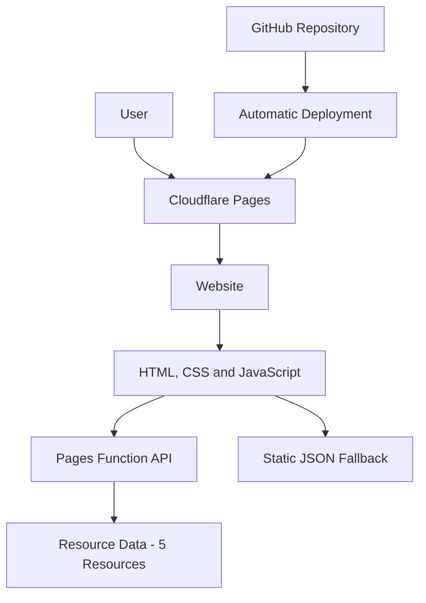

# Veda Internship Resource Portal – Architecture

## Architecture Explanation

1. **GitHub:** Stores the website source code and project files.
2. **Cloudflare Pages:** Hosts the website and automatically deploys updates from GitHub.
3. **Frontend:** HTML, CSS and JavaScript provide the user interface.
4. **Pages Function API:** Provides resource information through an API endpoint.
5. **Resource Data:** The API currently returns five sample learning resources.
6. **JSON Fallback:** The website can use its existing JSON resource data if the API is unavailable.
